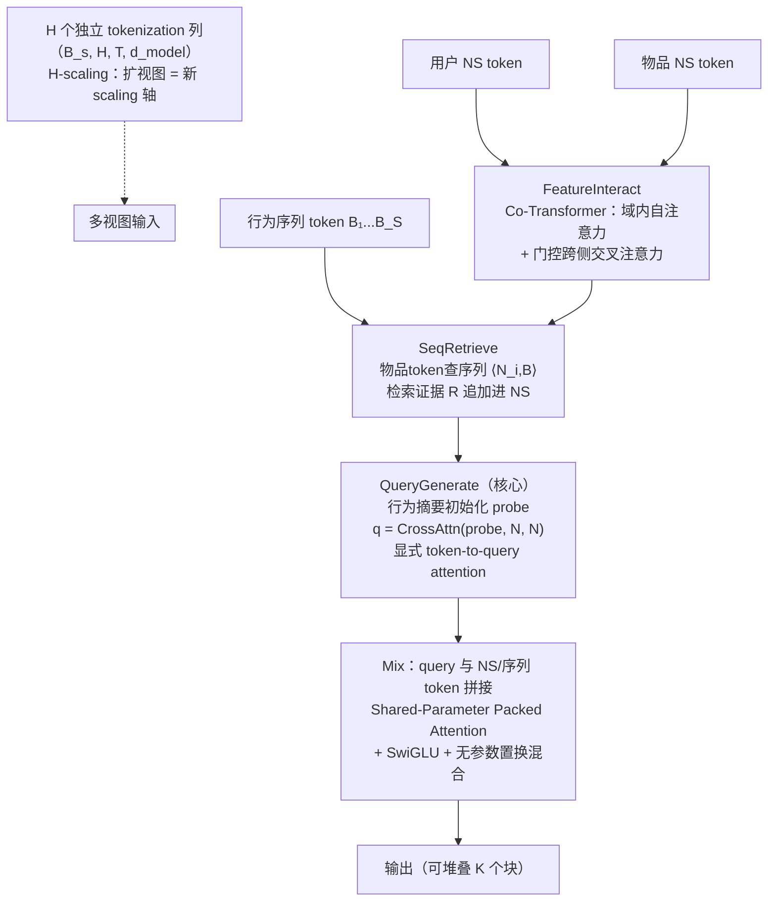
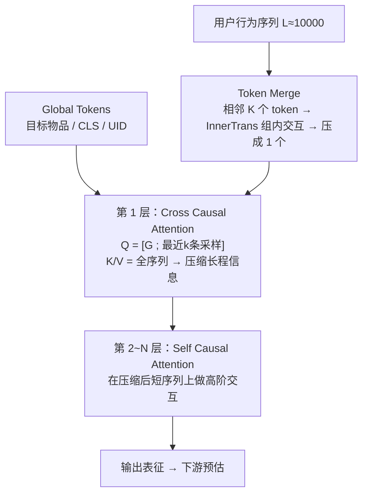
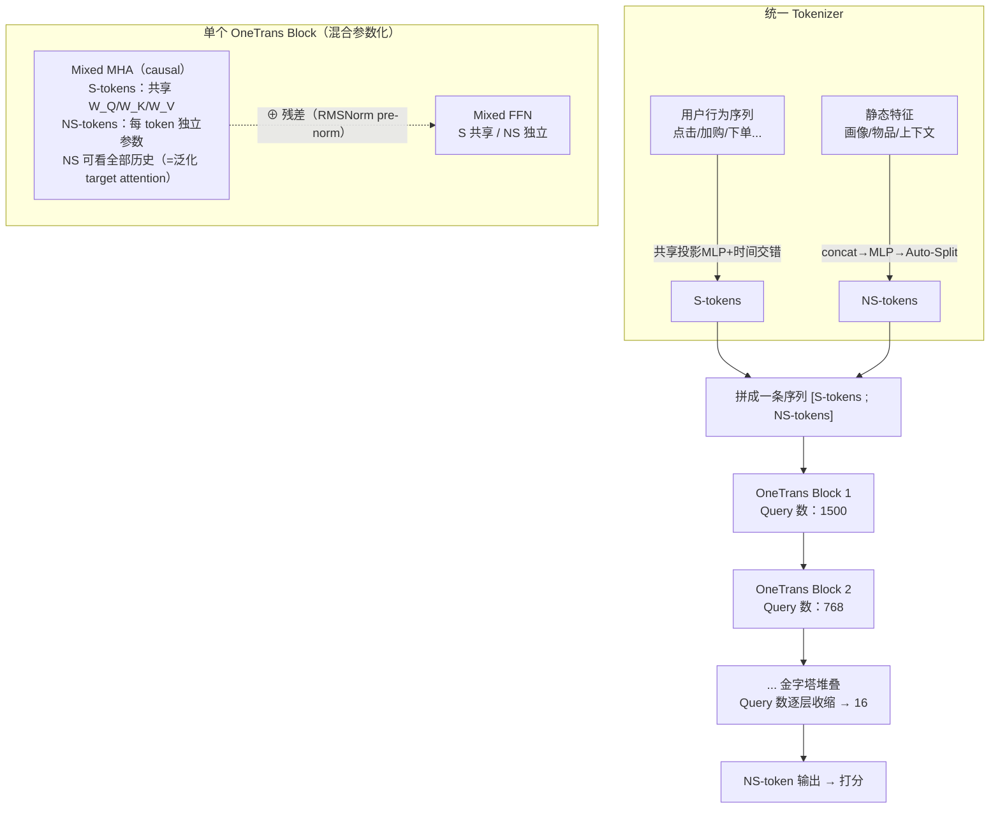
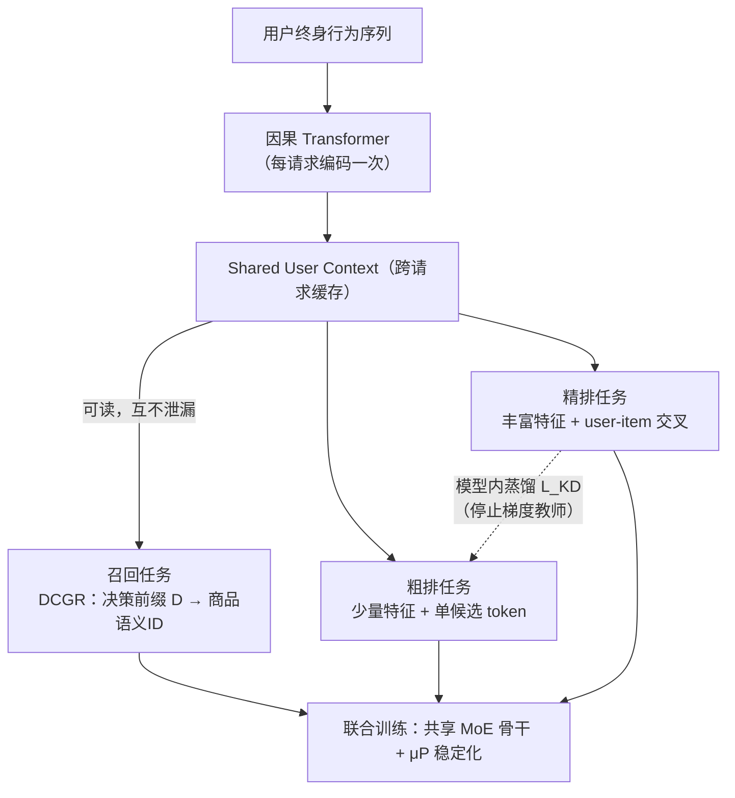
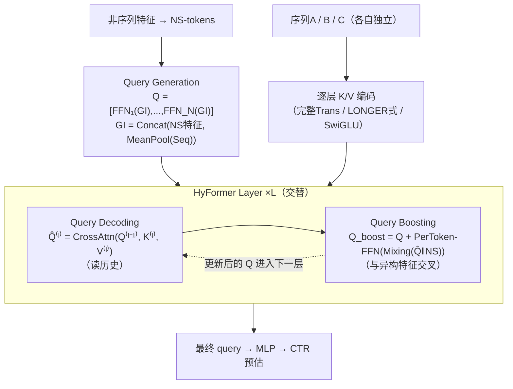
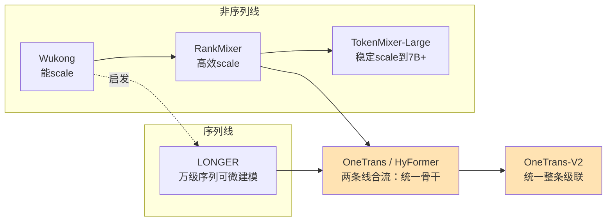

集中调研下Scaling在搜广推领域的进展。

<!--more-->

## 0. 背景：推荐精排为什么缺 Scaling Law

LLM 的公式是：**统一的 Transformer block + 堆参数堆数据 = 效果可预测地涨**。推荐精排模型做不到，卡点在输入异构：

- **行为序列**（用户几千条历史）由专门的序列模块（DIN/SIM 等）压缩成几个兴趣摘要向量；
- **静态特征**（画像、物品、上下文等几百个字段）由专门的特征交叉模块（FM/DCN）学习组合；

两个模块结构不同、各算各的，没法像 LLM 一样用同一种 block 无限堆叠；而传统"把 embedding 表加大"的扩容方式只增加记忆容量、不增强交互能力，还吃不满 GPU 算力。

过去两年，业界沿两条主线攻这个问题：**把特征交叉做成可堆叠 block（非序列线）**、**把长序列做成可堆叠 block（序列线）**，最终在 OneTrans / HyFormer 处合流。下面分别精读。

### 论文速查表

| 论文               | 机构/会议                          | 主线  | 一句话定位                           | 核心收益                           |
| ---------------- | ------------------------------ | --- | ------------------------------- | ------------------------------ |
| Wukong           | Meta, ICML 2024                | 非序列 | 堆叠 FM block，首个精排 Scaling Law    | 每 4×算力 ≈ +0.1% LogLoss         |
| RankMixer        | 字节, CIKM 2025                  | 非序列 | 无参数 Token Mixing 统一特征交叉         | MFU 4.5%→45%，参数×70 延迟不变        |
| TokenMixer-Large | 字节, arXiv 2602.06563           | 非序列 | RankMixer 的深层稳定扩展版              | 线上 7B 参数；电商订单 +1.66%           |
| QueryFormer      | 武大/中大, KDD Cup 2026 冠军         | 非序列 | cross-attention 生成 query 的统一桥接块 | test AUC 0.83254；H-scaling 近线性 |
| LONGER           | 字节, RecSys 2025                | 序列  | Token Merge + 混合注意力建模万级序列       | 序列长度拉到 10000，FLOPs −42.8%      |
| OneTrans         | 字节, WWW 2026                   | 序列  | 单 Transformer 统一序列建模+特征交叉       | GMV/u +5.68%，p99 延迟反降          |
| OneTrans-V2      | 字节, arXiv 2609.28589           | 序列  | 统一召回/粗排/精排整个级联                  | GMV +9.74%，吞吐 3.2×             |
| HyFormer         | 字节 TikTok 搜索, arXiv 2601.12681 | 序列  | 查询解码+查询增强交替统一                   | 人均完播 +1.111%                   |

---

# 第一部分 非序列 Scaling：特征交叉骨干的扩容

这一支**不处理原始序列**（序列信息以池化摘要等形式作为普通特征进入模型），要解决的问题是：**把"特征交叉"模块设计成硬件友好、可无限堆叠的同构 block**，从而像 LLM 一样加深度加宽度。

## 1.1 Wukong：给推荐系统立 Scaling Law 的开山之作

> *Wukong: Towards a Scaling Law for Large-Scale Recommendation*，Meta，ICML 2024，[arXiv:2403.02545](https://arxiv.org/abs/2403.02545)

### 动机

传统推荐模型扩容 = 扩 embedding 表（**稀疏 scaling**）：只增加记忆容量，学不到特征之间的高阶交互；且查表是访存密集操作，无法利用新一代加速器的算力红利。而现有交互模型（DCNv2、AutoInt+ 等）加深后收益迅速衰减、训练不稳定。Wukong 的目标：设计一个可堆叠的交互架构，让模型在数据、算力、参数同步放大时效果持续可预测地涨——**Dense Scaling（密集扩容）**。

### 建模思路与公式

核心创新：**把一叠 Factorization Machine 当积木堆**，灵感来自二进制幂运算——第 1 层 FM 抓二阶交互，第 2 层对二阶结果再交互得到四阶，**第 $i$ 层理论上能覆盖到 $2^i$ 阶交互**。层数线性增加，可表达交互阶数指数增长，这是"可扩展性"的数学根源（对比 HOFM 的线性增长）。

每个 Wukong 层由两个并行模块组成：

**① FMB（Factorization Machine Block）**：先做基础 FM 显式两两交互（遵循 DLRM）：

$\mathrm{FM}(X) = XX^\top$

当 $d \le n$ 时 $XX^\top$ 是秩为 $d$ 的低秩矩阵，引入可学习投影矩阵 $Y \in \mathbb{R}^{n\times k}$（$k \ll n$），利用结合律先算 $X^\top Y$，把复杂度从 $O(n^2 d)$ 降到 $O(nkd)$：

$XX^\top \;\rightarrow\; XX^\top Y$

FM 输出经 flatten → LayerNorm → MLP → reshape 回 $n_F$ 个新 embedding（编码交互结果）：

$\mathrm{FMB}(X_i) = \mathrm{reshape}\big(\mathrm{MLP}(\mathrm{LN}(\mathrm{flatten}(\mathrm{FM}(X_i))))\big)$

**② LCB（Linear Compress Block）**：线性重组 embedding，负责保留低阶信息、控制 embedding 数量：

$\mathrm{LCB}(X_i) = W_L X_i, \quad W_L \in \mathbb{R}^{n_L \times n_i}$

**③ 层整体公式**（FMB 与 LCB 输出拼接 + 残差 + LayerNorm）：

$X_{i+1} = \mathrm{LN}\big(\mathrm{concat}(\mathrm{FMB}_i(X_i), \mathrm{LCB}_i(X_i)) + X_i\big)$

**交互阶数翻倍的归纳论证**：设第 $i$ 层输入含 1 到 $2^{i-1}$ 阶交互；FMB 对两个阶数分别为 $o_1, o_2$ 的交互生成 $(o_1+o_2)$ 阶交互，故输出上界为两个 $2^{i-1}$ 阶结果相乘的 $2^i$ 阶，下界为 LCB 保留的 1 阶。**每加一层，最高交互阶数翻倍**。

得益于这个指数机制，层数只需 $\log n$ 量级，总复杂度：

$O(ndh + l\, n' dh + h^2) \approx O(ndh \log n + h^2)$

**Scaling 策略**：先加层数 $l$（提升可捕获交互阶数上限），再扩大 $n_F, n_L, k$ 与 MLP 宽度。消融显示加深度和 MLP 宽度收益最大。

### 模型结构图

### 实验结果

- **6 个公开数据集**：AUC 全面超过 DLRM、DCNv2、AutoInt+ 等 SOTA；
- **Meta 内部数据集**（1460 亿样本、720 特征）：在**两个数量级**的算力区间（>100 GFLOP/样本，总训练算力 2336 PF-days，接近 GPT-3 的 3640 PF-days）保持 log-linear Scaling Law；每 4 倍算力约 +0.1% LogLoss；参数最大做到 **637B** 曲线仍未饱和；模型越大数据效率越高。

### 点评

意义不在数字而在**首次证明推荐模型也可以有 Scaling Law**——前提是把架构设计成"可堆叠的同构 block"。

---

## 1.2 RankMixer：硬件感知的统一特征交叉骨干

> *RankMixer: Scaling Up Ranking Models in Industrial Recommenders*，字节跳动，CIKM 2025，[arXiv:2507.15551](https://arxiv.org/abs/2507.15551)

### 动机

工业推荐有严格延迟和 QPS 红线，而老一代精排里的手搓特征交叉模块（FM、DCN、SENet……）继承自 CPU 时代，算子碎片化、访存密集，GPU 上 MFU 只有 **4.5%**——即使 scaling law 成立，砸的算力 95% 在空转。RankMixer 要做一个**硬件对齐的统一架构**，把所有手搓模块替换成一个高并发 block，让"加参数"真正等价于"加效果"。

### 建模思路与公式

可以理解为"**把 Transformer 里的 Self-Attention 换成一个无参数的 token 混洗操作**"。

**① 语义分组 Tokenization**：语义相近的特征拼接后按固定维度切分为 $T$ 个 token：

$\mathbf{x}_i = \mathrm{Proj}\big(\mathbf{e}_{\text{input}}[d\cdot(i-1): d\cdot i]\big),\ i=1,\dots,T$

**② Multi-head Token Mixing（无参数）**：

(a) 每个 token 在维度上均分为 $H$ 个 head（每个 head 是 token 在低维子空间的投影）：

|                                                                                           |   |   |
| ----------------------------------------------------------------------------------------- | - | - |
| $[\mathbf{x}_t^{(1)} \| \cdots \| \mathbf{x}_t^{(H)}] = \mathrm{SplitHead}(\mathbf{x}_t)$ |   |   |

(b) 把所有 token 的**同一 head** 跨 token 拼接成混合 token——这一步同时完成了 $T$ 个 token 之间的全量信息交换，且不计算任何内积相似度：

$\mathbf{s}^h = \mathrm{Concat}(\mathbf{x}_1^h, \mathbf{x}_2^h, \dots, \mathbf{x}_T^h), \quad \mathbf{S}\in\mathbb{R}^{H\times TD/H}$

论文设 $H = T$ 使 token 数不变以便残差连接。Token Mixing 是纯重排算子，无 $O(T^2)$ 的注意力矩阵计算与 IO 开销（消融：换成 Self-Attention AUC 反降 0.03% 且 FLOPs +71.8%）。

**③ Per-token FFN（逐 token 独立参数）**：Mixing 后每个 token 恰好包含所有原始 token 的一个 head；若共享 FFN 会导致 token 表示趋同坍缩。因此每个 token 独享一套两层 MLP：

$\mathbf{v}_t = f_{\text{pffn}}^{t,2}\Big(\mathrm{Gelu}\big(f_{\text{pffn}}^{t,1}(\mathbf{s}_t)\big)\Big), \quad f_{\text{pffn}}^{t,i}(\mathbf{x}) = \mathbf{x}\mathbf{W}^{t,i}_{\text{pffn}} + \mathbf{b}^{t,i}_{\text{pffn}}$

$\mathbf{W}^{t,1}\in\mathbb{R}^{D\times kD}$、$\mathbf{W}^{t,2}\in\mathbb{R}^{kD\times D}$，$k$ 为扩展比。Per-token 设计避免"高频特征主导低频特征"，且加参数不加计算复杂度。

**④ Block 整体**（pre-LN 残差，堆 $L$ 层）：

$\mathbf{S}_{n-1} = \mathrm{LN}\big(\mathrm{TokenMixing}(\mathbf{X}_{n-1}) + \mathbf{X}_{n-1}\big), \quad \mathbf{X}_n = \mathrm{LN}\big(\mathrm{PFFN}(\mathbf{S}_{n-1}) + \mathbf{S}_{n-1}\big)$

参数量与 FLOPs：$\text{\#Param}\approx 2kLTD^2$，$\text{FLOPs}\approx 4kLTD^2$——规整的 dense GEMM，GPU 极友好。

**⑤ Sparse-MoE 扩容**：把 PFFN 换成 MoE，两个关键设计：

- **ReLU 路由 + 自适应 L1 惩罚**（替代 Top-k softmax）：token 按信息量激活**可变数量**的专家，全程可微：

$G_{i,j} = \mathrm{ReLU}\big(h(\mathbf{s}_i)\big),\quad \mathbf{v}_i = \sum_{j=1}^{N_e} G_{i,j}\, e_{i,j}(\mathbf{s}_i),\quad \mathcal{L} = \mathcal{L}_{\text{task}} + \lambda\sum_{i,j} G_{i,j}$

- **DTSI-MoE（稠密训练/稀疏推理）**：训练用两个 router（$h_{\text{train}}$ 无稀疏约束保证专家吃满梯度，$h_{\text{infer}}$ 受 L1 约束），推理只用 $h_{\text{infer}}$——解决"专家欠训练"问题。

### 模型结构图

### 实验结果

在抖音万亿级生产数据集上：

- **效率质变**：MFU 从 **4.5% → 45%**；密集参数 15.8M → **1.1B（70 倍）**，推理延迟几乎不变（14.5ms → 14.3ms）；
- **离线**：相对 DLRM-MLP 完播 AUC +0.64%、跳过 AUC +0.86%，Scaling 曲线比 Wukong、DHEN 等所有基线更陡；
- **线上**：1B 版本全量上线，用户活跃天数 +0.3%，总使用时长 +1.08%；推荐/广告/搜索三场景 A/B 均正。

### 点评

回答了"Scaling 的钱怎么花在刀刃上"：**先统一算子、拉满硬件利用率，再谈加参数**。

---

## 1.3 TokenMixer-Large：把 RankMixer 稳稳推到百亿参数

> *TokenMixer-Large: Scaling Up Large Ranking Models in Industrial Recommenders*，字节跳动 AML，[arXiv:2602.06563](https://arxiv.org/abs/2602.06563)

### 动机

RankMixer 打通了路，但往**深**里堆会遇到瓶颈：残差路径设计次优、深层梯度消失、MoE 稀疏化不彻底。一句话：**能 scale ≠ 能稳定地 scale 到很大**。

### 建模思路与公式

四个升级全部围绕"深层稳定训练"：

**① Mixing-and-Reverting**：token 混合设计成"混过去再混回来"的双向形式，信息不单程耗散，为梯度提供干净通路：

$\mathrm{MixRev}(X) = \mathrm{Revert}\big(\mathrm{Mix}(X)\big)$

**② Inter-layer Residual（层间残差）**：block 输出跨层直连，深 stack 下梯度稳定：

$X_{l+1} = X_{l-1} + \mathrm{Block}(X_l) \quad \text{（区别于普通 } X_{l+1} = X_l + \mathrm{Block}(X_l)\text{）}$

**③ Auxiliary Loss（辅助损失）**：在中层加辅助监督头，给深层直接梯度信号：

$\mathcal{L} = \mathcal{L}_{\text{main}} + \sum_{l} \lambda_l \, \mathcal{L}_{\text{aux}}^{(l)}$

**④ Sparse Per-token MoE**：MoE 与 Per-token 结构结合，参数扩展与激活算力解耦。

### 模型结构图

### 实验结果

- 参数规模：**线上 7B、离线 15B**——精排 dense 参数新量级；
- 电商：订单 **+1.66%**、人均预览支付 GMV **+2.98%**；广告 ADSS **+2.0%**；直播收入 **+1.4%**；已在字节多场景全量部署。

### 点评

RankMixer 路线的"工业化补完"：主干能变大（RankMixer）→ **稳定**变得很大（TokenMixer-Large），把稠密精排正式推进十亿~百亿参数时代。

---

## 1.4 QueryFormer：cross-attention 生成 query 的统一桥接块

> *QueryFormer: Winning Solution for KDD Cup 2026 Tencent UniRec Challenge*，武汉大学 & 中山大学，[arXiv:2609.16548](https://arxiv.org/abs/2609.16548)

### 动机

现有统一架构（含 HyFormer 类方法）用 **MLP 投影生成 query token**——query 是模型的信息中枢，但生成过程中缺乏显式的 token-to-query attention 精修。QueryFormer 的观察：query 质量是统一 block 效果的最大变量，值得用 attention 专门做。它提出一个 **token-in/token-out 的可堆叠统一 field–sequence 桥接块**，在 KDD Cup 2026 腾讯 UniRec 挑战赛工业赛道夺冠。

### 建模思路与公式

**① 总管线**（$N=N_u\cup N_i$ 为用户/物品 NS token，$B=\{B_1,\dots,B_S\}$ 为 $S$ 个域的行为序列 token）：

$N' = \mathrm{FeatureInteract}(N_u, N_i), \quad R = \mathrm{SeqRetrieve}(N'_i, B)$  
$Q = \mathrm{QueryGenerate}\big(\mathrm{pool}(B),\ N' \cup R\big), \quad Y = \mathrm{Mix}(Q, N', B)$

逻辑是双向检索：**NS token 先去序列里检索证据，生成的 query 再回头精修 NS 上下文**。

**② QuerySeqCrossAttn（query 生成，核心创新）**：每个序列域用池化行为摘要初始化 $N_q=2$ 个 probe，probe 对精炼后的 NS token 做交叉注意力（**以 probe 为 query、NS token 同时作 K/V**），得到上下文感知的 query：

$\mathbf{q}_{d,k} = \mathrm{CrossAttn}_d\big(\mathbf{q}_{d,k}^{(0)},\ \mathbf{N},\ \mathbf{N}\big)$

这与用 MLP 生成 query（$\mathbf{q}=\mathrm{MLP}(\mathrm{pool}(B)\oplus\mathbf{N})$）的本质区别：query 是**逐 token 对齐检索**出来的，而非一次性投影。

**③ QuerySeqCrossAttn 与 QuerySeqCrossAttn 的方向对比**：

| 机制                          | 方向                      | 含义                              |
| --------------------------- | ----------------------- | ------------------------------- |
| QuerySeqCrossAttn（检索）       | $\langle N_i, B\rangle$ | 物品 NS token 查序列，检索行为证据追加进 NS 集合 |
| SeqQueryCrossAttn（query 生成） | $\langle Q_B, N\rangle$ | 行为初始化的 query probe 查 NS 上下文     |

**④ Shared-Parameter Packed Attention**：多视图的序列 query **拼接后由共享参数的 cross-attention 一次算完**（而非逐视图串行），摊薄 K/V 投影与 kernel 开销，$H=8$ 延迟仅为 $H=1$ 的 1.89×。

**⑤ H 视图宽度——一个新的 scaling 轴**：embedding 矩阵带 $H$ 个独立列，每列独立 token 化，产出 $(B_s, H, T, d_{\text{model}})$ 张量，一次前向实现"视图多样性"。**H-scaling = 扩视图数而非加深加宽**，是网格中最强的缩放方向（幂律指数 $k=0.924$，接近线性；对比 $d_{\text{model}}$-scaling 仅 $k=0.286$）。

### 模型结构图

**论文原图**（来源：[arXiv:2609.16548](https://arxiv.org/abs/2609.16548) 原论文 Figure 1）：

**结构拆解**：

### 实验结果

- **工业赛道冠军**：官方 test AUC **0.83254**（赛后小幅扩到 0.832713）；
- **H-scaling**：验证 AUC 0.84540（H=1）→ 0.84615（H=8）单调提升，同等预算下优于 HyFormer；H=4 为延迟约束下的实际最优工作点；
- **消融**：query 生成是最大贡献模块。

### 点评

把"query 怎么生成"从 MLP 投影升级为显式 cross-attention，并贡献了一个新 scaling 轴（视图多样性）——竞赛级预算下验证了"**同等参数优先分配给视图多样性而非表示深度**"。

### 第一部分小结：非序列线的演进逻辑

**Wukong**（证明交互 block 能 scale）→ **RankMixer**（统一算子、硬件对齐、高效 scale）→ **TokenMixer-Large**（稳定 scale 到 7B/15B）→ **QueryFormer**（细化 query 生成质量 + 新增视图 scaling 轴）。共同的设计语法：**无参数/轻参数的 token 混合 + 逐 token 独立 FFN**——既保住异构特征的独立语义，又是规整 dense 计算。

---

# 第二部分 序列 Scaling：用户行为序列建模的扩容

这一支处理真正的行为序列（几千到上万条）。核心矛盾：**序列越长信息越多，但标准 Transformer 是 $O(L^2)$**。工业界旧方案（SIM/TWIN 两阶段硬检索）有损且上下游割裂。这条线的论文回答：怎么让长序列**端到端、可微、可 scale**。

## 2.1 LONGER：万级长序列的端到端建模

> *LONGER: Scaling Up Long Sequence Modeling in Industrial Recommenders*，字节跳动，RecSys 2025，[arXiv:2505.04421](https://arxiv.org/abs/2505.04421)

### 动机

用户历史动辄 $L\ge 2000$（工业场景 $d=32$，$L\gg d$），标准 Transformer 的 $O(L^2)$ 注意力不可承受；截断丢长程信息，两阶段硬检索切断可微路径。LONGER 目标：**万级序列、端到端可微、计算高效**。

### 建模思路与公式

**① Global Tokens（全局锚点）**：把目标物品、UID、CLS 等辅助表示作为 $m$ 个全局 token 挂在序列头上。它们拥有全量感受野，既能汇聚全序列信息，又能稳定长序列下的注意力分布（缓解 attention sink）。

**② Token Merge（令牌合并）**：相邻 $K$ 个 token 分组压缩为 1 个，序列长度 $L \to L/K$；组内插入轻量 **InnerTrans**（小型 transformer）保留局部交互细节，压缩不失真：

$\underbrace{s_1,\dots,s_K}_{\text{一组}} \xrightarrow{\text{InnerTrans 组内交互}} \text{concat} \xrightarrow{\text{压缩}} s'_1$

对比 vanilla transformer 的开销（$L=2000, d=32$ 时注意力项主导）：

$\mathrm{FLOPs}_{\text{vanilla}} = 24Ld^2 + 4L^2d$

Merge 后 $L$ 缩为 $L/K$，二次项直接除以 $K^2$。

**③ 混合注意力（核心）**：Query 矩阵由全局 token 与最近 $k$ 条采样 token 拼接而成（实验发现"取最近 k 条"优于均匀采样和可学习 token；采样最近 40% 即保留 95% 收益）：

$\mathbf{O} = [\,\mathbf{G}\,;\,\mathbf{H_S}\,], \quad \mathbf{G}\in\mathbb{R}^{m\times d}\ \text{（全局token）},\ \mathbf{H_S}\in\mathbb{R}^{k\times d}\ \text{（最近k条）}$

- **第 1 层：Cross Causal Attention**——$\mathbf{O}$ 作为 Q，对全序列（全局 token + 完整历史）做交叉注意力，一次性把长程信息压缩进 $[\mathbf{G};\mathbf{H_S}]$；
- **第 2~N 层：Self Causal Attention**——在压缩后的短序列上堆自注意力，做高阶交互。

即"**一次 cross 压缩全序列，多层 self 提炼高阶**"，总注意力成本从 $O(L^2d)$ 降到 $O(Lkd)$ + $O((m+k)^2 d)$。

### 模型结构图

**论文原图**（来源：[arXiv:2505.04421](https://arxiv.org/abs/2505.04421) 原论文模型结构图）：

**结构拆解**：

### 实验结果

- Token Merge 节省 **~42.8% FLOPs** 而效果基本无损；
- 对比 SIM/TWIN 两阶段检索：端到端可微，无硬检索信息损失；
- 已在字节数十场景（含抖音）部署，**序列长度拉到 10000**。

### 点评

序列 scaling 的算法标杆：**压缩（Merge）+ 稀疏化（最近采样）+ 精炼（self attention）**&#x4E09;段式，是后续统一架构中序列编码器的常见选项。

---

## 2.2 OneTrans：一个 Transformer 同时干两份活

> *OneTrans: Unified Feature Interaction and Sequence Modeling with One Transformer in Industrial Recommender*，字节跳动，WWW 2026，[arXiv:2510.26104](https://arxiv.org/abs/2510.26104)

### 动机

此前两条线各自 scaling 成功（交叉侧 Wukong/RankMixer，序列侧 LONGER），但"**先编码序列、再与特征交叉**"（encode-then-interaction）流水线有三个硬伤：静态特征无法参与塑造序列表征（late fusion，信息单向）；两个模块两次执行、无法统一优化；两种 block 长得不一样、没法一起堆。

### 建模思路与公式

OneTrans 的答案：**把序列 token 和静态特征 token 拼成一条序列，用一个 causal Transformer 全部搞定**。

**① 统一 Tokenizer**：序列特征过一个共享投影 MLP 对齐维度后按时间戳交错成 S-tokens（多序列间插 `[SEP]`）；非序列特征用 **Auto-Split**（全部 concat 过一个 MLP 后自动切分）生成 NS-tokens——消融显示 Auto-Split 全面优于人工语义分组（−0.30% UAUC）。

**② 混合参数化（Mixed Parameterization，核心设计）**：异构 token 共处的关键是"一部分共享 + 一部分独享"：

- 所有 S-tokens **共享**一套 $W^Q, W^K, W^V, W^{FFN}$（行为 token 同质，参数量与序列长度解耦）；
- 每个 NS-token **独享**一套参数（保住几百个异构特征各自的语义判别性，继承 RankMixer 的 Per-token 思想）：

$\mathrm{Attn}: \begin{cases} \mathbf{s}_i: & \mathbf{s}_i\, W^Q_{\text{shared}} \\ \mathbf{n}_j: & \mathbf{n}_j\, W^Q_{j} \end{cases}$

配套细节：pre-norm RMSNorm（post-norm 会因异构 token 统计差异导致 attention collapse）。

**③ Causal Mask 的一石四鸟**：把 NS-tokens 排在 S-tokens 之后。于是：

- 每个 NS-token 能 attend 到**全部**行为历史 → 等价于做了一次全序列 target attention（DIN 的泛化版）；
- 每个 NS-token 还能看到前面的 NS-tokens → token 级特征交叉；
- S-tokens 之间保持因果 → 高意图行为（下单）先于低意图（曝光）时，强信号过滤弱信号；
- 消融证明 causal 与 full attention 效果一样（−0.05% AUC 差异）但保留了 KV cache 的可能性。

**④ 金字塔堆叠（Pyramid Stack）**：因果注意力让信息不断向序列尾部集中，于是每层只让最新的一个 S-token 子集发 Query（K/V 仍算全序列），query 数随深度线性收缩（OneTrans-L 从 1500 → 16，逐层取 32 的倍数）：

$\text{attention 成本}: O(L^2 d) \to O(L\,L' d), \quad L' \text{ 随深度递减}$

消融：保持全长 query 无任何收益（−0.05% AUC 但 3 倍 FLOPs）；同等算力预算下金字塔支撑约 **1.75 倍**的有效序列长度。

### 模型结构图

**论文原图**（来源：[arXiv:2510.26104](https://arxiv.org/abs/2510.26104) 原论文 Figure 1 / Figure 2）：

**结构拆解**：

### 实验结果

工业流式数据（291 亿曝光 / 2790 万用户），该系统标定 +0.1% AUC 即有意义：

- **离线**：同等算力下，OneTrans（+1.13%）比"单线加码"（RankMixer 换上去 +0.27%，序列模块再换 +0.57%）**多赚一倍**；大版本 CTR AUC **+1.53%**、UAUC +2.79%；
- **Scaling**：深度+宽度联合扩展呈 log-linear，**斜率比扩到 1B 的 RankMixer 更陡**——首次在"统一 vs 非统一骨干"间做受控对比；
- **线上**：click/u +7.74%，**GMV/u +5.68%**，冷启动商品订单/u +13.59%。

### 点评

"保守统一派"代表：不动级联、不动判别式打分，只把精排内两条 track 合成一条骨干。核心结论：**先统一、后加大，收益翻倍**。

---

## 2.3 OneTrans-V2：一个模型贯穿召回/粗排/精排

> *OneTrans-V2: Unifying Retrieval, Pre-rank, and Fine-rank with One Transformer in Industrial Recommender*，字节跳动全球电商，[arXiv:2609.28589](https://arxiv.org/abs/2609.28589)

### 动机

OneTrans 统一了一个精排模型内部，但级联层面仍有大浪费：召回/粗排/精排是三个独立模型，同一条用户序列被**重复编码**三次、三阶段目标不一致（粗排丢掉的候选精排救不回）、工程三倍建设。与 OneRec 式"推翻级联"不同，OneTrans-V2 **保留级联、统一用户侧**：逐级缩减候选的机制是成熟的，真正该共享的是"与候选无关的用户上下文"。

### 建模思路与公式

**① 共享用户上下文 + 阶段 token**：用户行为序列每请求只编码一次，缓存为 Shared User Context $C$；召回/粗排/精排作为**同一个 Transformer 的三个任务**，各自往 $C$ 上追加阶段 token（粗排用少特征单 token，精排用丰富特征多 token）。

**② 阶段可见性掩码（Stage Visibility Mask）**：各阶段 token 可读 $C$，但互相隔离、不能改写历史——共享的是候选无关上下文，同时防止候选信息跨阶段泄漏：

$\text{stage } r \text{ 的 token} \;\to\; \text{可 attend } C \text{ 与本阶段 token，不可见其他阶段 token}$

**③ 联合训练 + 模型内蒸馏**：三阶段共享底座共同训练；精排（教师，停止梯度）把候选偏好教给粗排（学生），先对两阶段 logit 做均值中心化和温度缩放再算 BCE：

$\mathcal{L}_{\text{KD}} = \mathrm{BCE}\Big(\sigma(z_{\text{pre}}),\ \mathrm{stopgrad}\big(\sigma(\tilde{z}_{\text{fine}})\big)\Big), \quad \tilde{z}_{\text{fine}} = \frac{z_{\text{fine}} - \mu}{\tau}$

总损失联合优化三个阶段任务 + 蒸馏项。

**④ DCGR（决策条件生成式召回）**：把多目标召回压进一个生成过程——先预测"决策前缀"再生成商品语义 ID。决策前缀含四维：购买层级、品类新颖度、自然/广告供给、客单价档位（前三并行组成第一个决策 token，客单价第二个，后接三级语义 ID，每级码本 8192）：

$p(\text{SID} \mid C, D) = \prod p(\text{SID}_j \mid C, D, \text{SID}_{<j}), \quad D = (\underbrace{D_{\text{购}}, D_{\text{品}}, D_{\text{供}}}_{\text{token 1}}, \underbrace{D_{\text{价}}}_{\text{token 2}})$

业务目标可以通过束搜索中的决策偏置 $b$ 直接引导生成分布。

**⑤ SNT（序列原生训练）**：把一个用户时间窗内的多次曝光组织成一批，行为序列只编码一次、跨曝光摊销（每曝光用请求时刻锚点控制可见历史），训练提速 4.4×。

### 模型结构图

**论文原图**（来源：[arXiv:2609.28589](https://arxiv.org/abs/2609.28589) 原论文 Figure 1 / Figure 2）：

**结构拆解**：

### 实验结果

- **全链路线上 A/B**（用户 50/50）：**GMV +9.74%**、活跃天数 +0.25%、同硬件端到端 QPS **3.2×**；
- 小版本在算力低于旧三级联的情况下，召回 HR@1 / 粗排 UAUC / 精排 UAUC 全赢；去掉蒸馏，粗排 UAUC 相对掉 0.97%；
- 联合训练（召回梯度可回传）相对分别训练：召回 HR@1 +15.44%；
- 多模态特征直接加给小模型 AUC 反降（−0.05%），大模型上才转正——**特征配方不能从大模型照搬到小模型**。

### 点评

统一化的下一站：**从"统一一个模型"到"统一一条链路"**。共享用户侧长历史与训练反馈，保留各阶段的候选特征与算力预算。

---

## 2.4 HyFormer：查询解码 + 查询增强的交替统一

> *HyFormer: Revisiting the Roles of Sequence Modeling and Feature Interaction in CTR Prediction*，字节 TikTok 搜索，[arXiv:2601.12681](https://arxiv.org/abs/2601.12681)

### 动机

HyFormer 把矛头指向当时最强的两段式组合"LONGER + RankMixer"：序列压缩器的 query token 只来自少量候选相关特征（几千条历史的"读取资格"只给了几个向量，且直接加 query 数会拖垮 KV-Cache 推理）；交叉发生在压缩之后（late fusion）；交互模块只见压缩表征，加参数只增强孤立组件，scaling 效率低。

### 建模思路与公式

HyFormer 把 LRM 建模重构为**交替优化**：Query Decoding（读序列）↔ Query Boosting（做交叉），逐层迭代。

**① Query Generation（查询生成）**：非序列特征（RankMixer 式语义分组为 NS-tokens）与各序列的 mean pooling 摘要拼接，过轻量 FFN 生成 $N$ 个语义 query：

$\text{Global Info} = \mathrm{Concat}\big(F_1,\dots,F_M,\ \mathrm{MeanPool}(Seq)\big)$  
$Q = \big[\mathrm{FFN}_1(\text{Global Info}), \dots, \mathrm{FFN}_N(\text{Global Info})\big] \in \mathbb{R}^{N\times D}$

浅层生成一次，深层复用上一层输出作为更新后的 query。

**② Query Decoding（查询解码）**：序列的逐层 K/V 编码支持三种方式（容量从高到低）：

$\text{(i) 完整编码：} H_l = \mathrm{TransformerEnc}_l(S)$  
$\text{(ii) LONGER 式：} H_l = \mathrm{CrossAttn}(S_{\text{short}},\ S,\ S), \quad O(L_S^2)\to O(L_H L_S)$  
$\text{(iii) 轻量编码：} H_l = \mathrm{SwiGLU}_l(S)$

逐层投影得 $K_l = H_l W^K_l,\ V_l = H_l W^V_l$，全局查询做交叉注意力"读历史"：

$\widehat{Q}^{(l)} = \mathrm{CrossAttn}\big(Q^{(l-1)},\ K^{(l)},\ V^{(l)}\big)$

**③ Query Boosting（查询增强）**：解码后的 query 与 NS-tokens 拼接（$T = N + M$），做 MLP-Mixer 式 token mixing + Per-token FFN（即 RankMixer 结构）：

|                                                                                                                                                                     |   |   |
| ------------------------------------------------------------------------------------------------------------------------------------------------------------------- | - | - |
| $q_t = [\,q_t^{(1)} \| \cdots \| q_t^{(T)}\,], \quad \tilde{q}_h = \mathrm{Concat}(q_1^{(h)}, \dots, q_T^{(h)}), \quad \hat{Q} = [\tilde{q}_1, \dots, \tilde{q}_T]$ |   |   |
| $Q_{\text{boost}} = Q + \mathrm{PerToken\text{-}FFN}(\hat{Q})$                                                                                                      |   |   |

残差连接保留原始解码语义。输出作为下一层输入 query，交替迭代。

**④ 多序列独立建模**：每条序列（搜索/信息流/互动）独立编码、配专属 query 组；跨序列交互推迟到 query 层面的 token mixing。消融显示序列直接拼接会掉 0.06% AUC。

### 模型结构图

**论文原图**（来源：[arXiv:2601.12681](https://arxiv.org/abs/2601.12681) 原论文 Figure 1）：

**结构拆解**：

### 实验结果

TikTok 搜索，70 天日志 30 亿样本（查询级 AUC）：

- **离线**：HyFormer 0.6489 vs LONGER+RankMixer 0.6478（**+0.17%**，同参数/FLOPs 预算）；消融证实全局 token、序列池化 token、目标物品信息缺一不可，多序列合并掉点；
- **Scaling**：以 LONGER+RankMixer 为基线，参数与 FLOPs 增大时曲线始终更高、斜率更好；
- **线上**：人均观看时长 +0.293%、人均完播播放 **+1.111%**、换 query 率 −0.236%（负向指标下降）；已全量部署。

### 点评

与 OneTrans 的区别：OneTrans 完全靠 attention 融合，HyFormer 每层在 cross-attention 之外**显式嵌入 RankMixer 结构**做特征混合——是多序列（搜索/推荐/广告并存）场景下更精细的统一方案。

### 第二部分小结：序列线的演进逻辑

**LONGER**（解决"长序列算不起"）→ **OneTrans**（解决"序列和特征两张皮"，统一骨干 + 金字塔省算力）→ **OneTrans-V2**（统一范围从模型扩展到整条级联）→ **HyFormer**（统一方式从"全靠 attention"细化为"解码+增强交替"）。合流后的共识：**序列 token 与静态特征 token 进同一条 token 流，用混合参数化吸收异构性，用因果注意力同时实现 target attention 与特征交叉**。

---

# 结语：两条线合流后的四条共识

1. **先统一，才能 scale**：同等算力下，"分离架构上继续单线加码"的收益只有"统一后加大"的一半（OneTrans：+0.57% vs +1.13%）；
2. **异构性靠参数化设计吸收**："一部分共享（同质 token）+ 一部分独享（异质 token）"是所有统一架构的标配；
3. **query 质量是序列建模的杠杆**：从 LONGER 的少量全局 token，到 HyFormer 的逐层精修 query，再到 QueryFormer 的 cross-attention 生成 query——query 越丰富、交互越早，scaling 效率越高；
4. **统一之后，scaling 还在继续**：TokenMixer-Large 推到 7B/15B，OneTrans-V2 用 MoE+μP 继续加大共享骨干——精排的"GPT 时刻"正在到来。

## 论文链接

| 论文                    | 链接                                 |
| --------------------- | ---------------------------------- |
| Wukong (ICML 2024)    | <https://arxiv.org/abs/2403.02545> |
| RankMixer (CIKM 2025) | <https://arxiv.org/abs/2507.15551> |
| TokenMixer-Large      | <https://arxiv.org/abs/2602.06563> |
| QueryFormer           | <https://arxiv.org/abs/2609.16548> |
| LONGER (RecSys 2025)  | <https://arxiv.org/abs/2505.04421> |
| OneTrans (WWW 2026)   | <https://arxiv.org/abs/2510.26104> |
| OneTrans-V2           | <https://arxiv.org/abs/2609.28589> |
| HyFormer              | <https://arxiv.org/abs/2601.12681> |

---

*阅读建议：先读 Wukong → RankMixer → LONGER → OneTrans 打底，其余四篇（TokenMixer-Large / QueryFormer / OneTrans-V2 / HyFormer）均为增量创新，读起来会非常快。*
